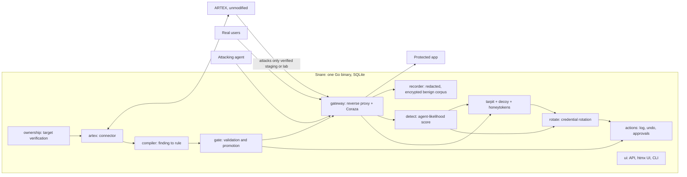

# Architecture

Snare sits in front of an application as a reverse proxy, and next to an
unmodified ARTEX instance as an API client. It turns what ARTEX proves about the
application into protections, and it watches production traffic for the
behavior of autonomous attack agents.

This document describes the target design and marks what exists today. The
milestone plan is in the README.

## Components



| Package | Responsibility | Status |
| --- | --- | --- |
| `internal/config` | Load `snare.yaml`, apply `SNARE_*` overrides, validate with all problems listed at once | M0, done |
| `internal/store` | SQLite (`modernc.org/sqlite`, no CGO), embedded numbered migrations, secret files | M0, done |
| `internal/ui` | Authenticated API (`/api/status`, `/api/corpus/coverage`), unauthenticated `/healthz`; htmx UI later | partial, M8 |
| `internal/artex` | ARTEX client. M0: health, auth status, login, session check | M0 partial, M3 |
| `internal/gateway` | Reverse proxy, routing, hard limits, per-source caps, capture for recording; Coraza in M4 | M1, done |
| `internal/recorder` | Redaction, AES-256-GCM at rest, learning period, HAR import, coverage | M1, done |
| `internal/labnet` | Lab-only network helpers: egress allowlist proxy, fixed forwarders, latency comparison | M0/M1, done |
| `internal/detect` | Deterministic, explainable agent-likelihood score | M2 |
| `internal/compiler` | Finding plus proving exchange to a narrow SecLang rule, or a ticket | M4 |
| `internal/gate` | Promotion state machine, replay, soak, rollback | M4 |
| `internal/tarpit` | Lead-generating tarpit for certain-agent sources | M5 |
| `internal/decoy` | Decoy paths and honeytokens | M5 |
| `internal/rotate` | AWS IAM key deactivation, generic rotation webhook | M6 |
| `internal/ownership` | DNS TXT and well-known file verification, active-mode brakes | M7 |
| `internal/actions` | Append-only action log, undo handles, approvals queue | schema in M0, logic from M4 |

## Process model

`snare serve` runs everything in one process:

- the API and UI listener (`server.listen`, loopback by default, bearer token);
- the gateway listener (`gateway.listen`), from M1;
- background loops (webhook processing, soak timers, re-verification,
  regression replay), from M3 onward.

All state is in one SQLite file. Passive mode needs no other service. Active
mode needs an ARTEX instance reachable over HTTP.

## Data flow for a finding

1. ARTEX proves a hole in a verified target and posts a webhook to Snare.
2. The connector verifies the shared secret, deduplicates by finding ID and
   status, and fetches the finding, its lineage, and its bound proving
   exchanges from the ARTEX API.
3. The compiler turns the finding into a candidate rule scoped to method,
   path, parameter and payload class, or into a human ticket for classes a WAF
   cannot fix honestly (IDOR, business logic, broken auth).
4. The gate moves the rule through
   `candidate -> detect_only -> soaking -> enforced -> rolled_back | retired`,
   replaying the stored exploit and the benign corpus, soaking on live traffic,
   and finally asking ARTEX to retest through Snare. Before the corpus is
   replayed it is prepared against poisoning (see THREAT_MODEL.md):
   entries matching the compiler's exploit-class templates are quarantined,
   and the rest are grouped by request shape and weighted by the number of
   distinct sources that sent each shape, so one source cannot define what
   "normal" looks like for a route.
5. Every transition is an action log row with evidence and an undo handle.

## Trust boundaries

- Protected-app traffic, attacker traffic, and ARTEX output are untrusted data.
  No component interprets them as instructions. When an optional model is
  used (off by default), untrusted text is framed as data and the output is
  only ever a candidate that must pass the deterministic gate.
- The action log is enforced append-only in the schema (SQLite triggers reject
  UPDATE and DELETE), and its `actor` column accepts only `policy` or `human`.
  A model can never be the actor of an action.
- Snare's API requires a bearer token. The API binds to loopback unless
  `server.allow_non_loopback` is set.

## The lab

`deploy/compose` defines the development lab. The network is the boundary
that keeps ARTEX on lab targets: ARTEX is attached only to Docker `internal`
networks, which have no route or DNS to the internet.

```
 host 127.0.0.1:  8000, 8780                         8787
                      |                                |
 front (bridge)  [ snare-ports ]                  [ artex-ui ]
                      | snare-admin (internal)         | artex-admin (internal)
 target (internal)    |                                |
   juice-shop ---- [ snare ]                           |
                      |                                |
 lab (internal)  -----+---- playwright (on demand)     |
   10.203.0.0/24      |                                |
                      +----------------------- [ artex 10.203.0.10 ]
                                                   |  |
 artex-db (internal)      postgres ----------------+  +--- [ egress ] -- outbound (bridge) --> api.deepseek.com:443 only
                                                     llm-egress (internal)
```

Containment rule: ARTEX and every container ARTEX can reach, directly or
through another container, are on internal networks only. `egress`,
`artex-ui` and `snare-ports` are the declared exceptions; each reaches only
fixed or allowlisted destinations.

- Juice Shop is attached only to `target`, which it shares with Snare alone.
  ARTEX, the Playwright runner and the host reach it only through Snare's
  gateway, so every attack request passes Snare. Snare itself has no
  internet access, because ARTEX can reach it.
- ARTEX has a fixed address on `lab`, and its capture proxy adds a secret
  `X-Snare-Scanner` header to every request to Snare. Snare removes the
  header and keeps both kinds of request out of the benign corpus.
- ARTEX reaches the internet only through `egress`, an allowlisting CONNECT
  proxy (`internal/labnet`) set as `ARTEX_LLM_PROXY`. It allows exactly the
  hosts in `LLM_EGRESS_ALLOW` and refuses everything else.
- ARTEX runs as an offline overlay of the unmodified image: nuclei templates
  are baked in at a pinned release and tool self-updates are off
  (`deploy/compose/artex-offline`).
- `lab.sh up` generates secrets, builds everything, waits for health, performs
  ARTEX's first-run claim (it reads the one-time setup token from the ARTEX log
  and calls `POST /api/auth/init`), forces ARTEX web search off, and checks
  that Snare can log in to ARTEX, and installs the scanner header rewrite
  rule in ARTEX. `lab.sh test` runs the isolation test from inside the ARTEX
  container, the containment audit, the SSRF pivot test, the corpus
  exclusion test, and the Go client's integration test against the real
  container.
- `lab.sh capture-run` is the one recorded ARTEX run (DeepSeek, braked by a
  token budget, a hard stop and a wall-clock limit). Snare writes ARTEX's
  traffic to a capture file for test data; see `bench/results/llm-spend.md`
  for what each run cost.

## ARTEX interface

Snare uses only ARTEX's HTTP API and its generic webhook notification channel.
The endpoints and the facts Snare depends on, with the file each was verified
in, are listed in [ASSUMPTIONS.md](ASSUMPTIONS.md#artex-interface-notes).
Changes Snare would like from ARTEX are written as patches with proposed pull
request descriptions under [upstream/](upstream/).
